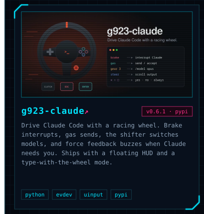
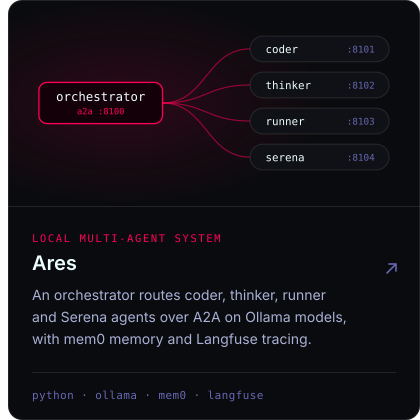
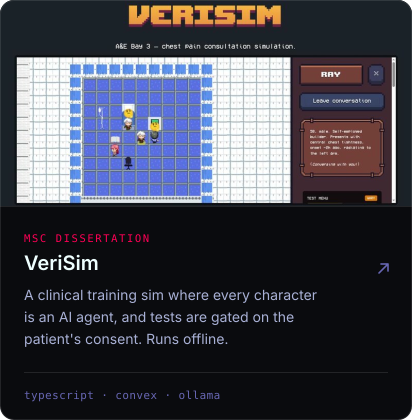
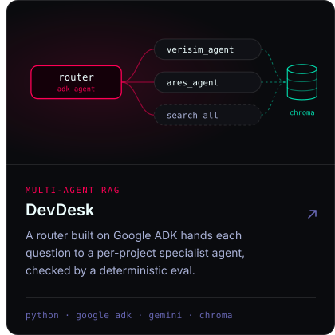
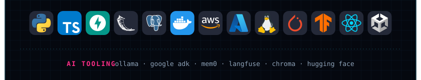

I build agentic AI systems: multi-agent orchestration, RAG with proper evaluation, and models that run locally.

[LinkedIn](https://linkedin.com/in/arjun-ashad-z) &nbsp;·&nbsp; Coventry, UK

 

### Selected work

 

### Experience

**Backend & Full-Stack Engineer** &nbsp;·&nbsp; FundedIn 
Freelance, remote &nbsp;·&nbsp; June 2026 to present

Shipped KYC identity verification gating trader payouts, a brokerage fee engine handling partial-fill capping and settlement, and AWS SQS outbox dispatch for order events, in a Dockerised CI/CD codebase with 13+ test modules.

**Clinical AI / EMR Tooling** &nbsp;·&nbsp; SACOM 
Private, under NDA

Ophthalmology workflow modules involving computer vision and voice-assisted documentation. The code and client data stay private under the NDA and healthcare privacy rules.

 

### Stack

AI tooling &nbsp;·&nbsp; Ollama, Google ADK, mem0, Langfuse, Chroma, Hugging Face
