  

  &nbsp;
  &nbsp;
  

  I build agentic AI systems: multi-agent orchestration, RAG with real evals, and models that run locally. 
  MSc Applied AI at the University of Warwick. Backend engineer at FundedIn.

---

<table>
<tr>
<td width="33%">

### Agentic AI
Multi-agent orchestration · RAG · LLM tool-use · local inference (Ollama) · Python

</td>
<td width="33%">

### Systems
FastAPI · Flask · SQL · Docker · AWS · Azure · Linux

</td>
<td width="33%">

### ML / Interactive
PyTorch · TensorFlow · HuggingFace · Unity · React · TypeScript

</td>
</tr>
</table>

## Featured Work

<table>
<tr>
<td width="33%">

### [Ares](https://github.com/Emperor-Z/aries)
Local, 100% offline multi-agent AI system - orchestrator, coder, thinker, runner, and Serena agents over Ollama, with mem0 memory, Langfuse observability, and A2A HTTP endpoints between agents.

`Python` `Ollama` `Docker` `Langfuse`

</td>
<td width="33%">

### [VeriSim](https://github.com/Emperor-Z/verisim)
MSc dissertation prototype: a persona-driven, multi-agent clinical training simulation where consent-gated clinical actions force communication skill and clinical reasoning together. Built on Ares for local agent orchestration.

`TypeScript` `Convex` `Ollama` `Multi-agent`

</td>
<td width="33%">

### [Sreenethra Clinical Platform](https://github.com/Emperor-Z/project_sreenethra_website_and_template)
Ophthalmology website and clinical UX work developed alongside a Unity-based amblyopia therapy game.

`HTML` `CSS` `TypeScript` `Unity`

</td>
</tr>
</table>

## Professional Experience

**Backend & Full-Stack Engineer** · FundedIn (Freelance, remote) · Jun 2026 - Present

Shipped KYC identity verification gating trader payouts, a brokerage fee engine handling partial-fill capping and settlement, and AWS SQS outbox dispatch for order events - in a Dockerised CI/CD codebase with 13+ test modules.

## Private / NDA Work

Worked on private clinical AI/EMR tooling at **SACOM**, including ophthalmology workflow modules involving computer vision and voice-assisted documentation. Code and client data are not public due to NDA and healthcare privacy constraints.

## Current Focus

`MSc Applied AI @ Warwick` · `agentic AI` · `multi-agent systems` · `RAG` · `local AI orchestration` · `healthcare AI`
