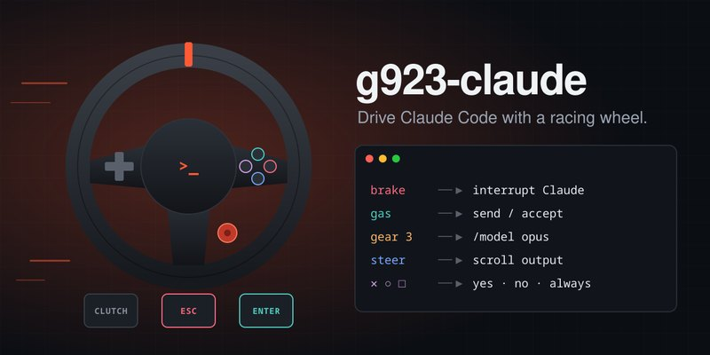
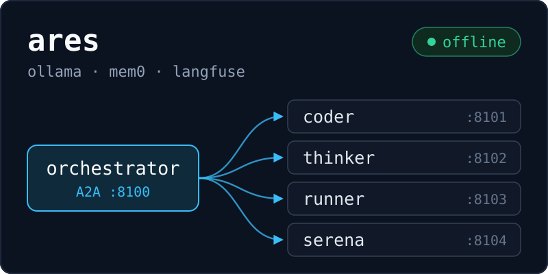
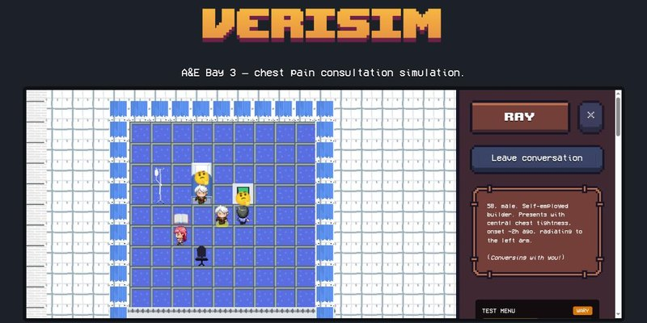
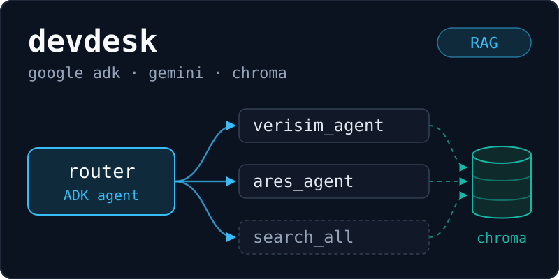

  

  &nbsp;
  &nbsp;
  

  I build agentic AI systems: multi-agent orchestration, RAG with real evals, and models that run locally. 
  MSc Applied AI at the University of Warwick. Backend engineer at FundedIn.

---

<table>
<tr>
<td width="33%">

### Agentic AI
Multi-agent orchestration · RAG · LLM tool-use · local inference (Ollama) · Python

</td>
<td width="33%">

### Systems
FastAPI · Flask · SQL · Docker · AWS · Azure · Linux

</td>
<td width="33%">

### ML / Interactive
PyTorch · TensorFlow · HuggingFace · Unity · React · TypeScript

</td>
</tr>
</table>

## Featured work

<table>
<tr>
<td width="50%" valign="top">

### [g923-claude](https://github.com/Emperor-Z/g923-claude)

Drive Claude Code with a racing wheel. Brake interrupts, gas sends, the shifter switches models, and force feedback buzzes when Claude needs you. Comes with a floating HUD and a type-with-the-wheel mode; released on PyPI.

`Python` `evdev` `uinput` `PyPI`

</td>
<td width="50%" valign="top">

### [Ares](https://github.com/Emperor-Z/ares)

A fully local multi-agent system. An orchestrator routes over A2A HTTP to coder, thinker, runner and Serena agents on Ollama models, with on-disk mem0 memory, Langfuse tracing, and routing it learns from your ratings.

`Python` `Ollama` `A2A` `mem0` `Langfuse`

</td>
</tr>
<tr>
<td width="50%" valign="top">

### [VeriSim](https://github.com/Emperor-Z/verisim)

My MSc dissertation prototype: a clinical training sim where the patient, a relative and a nurse are each an AI agent with its own persona. Tests are gated on patient consent, so the learner has to de-escalate before they can act. Runs offline on local models.

`TypeScript` `Convex` `Ollama` `Agents`

</td>
<td width="50%" valign="top">

### [DevDesk](https://github.com/Emperor-Z/devdesk)

Multi-agent RAG on Google ADK. A router delegates by explicit tool call to per-project specialist agents, each grounded in that project's docs through Chroma, and a deterministic eval with a holdout split keeps the routing honest.

`Python` `ADK` `Gemini` `Chroma` `RAG`

</td>
</tr>
</table>

Also: [Sreenethra clinical platform](https://github.com/Emperor-Z/project_sreenethra_website_and_template) (ophthalmology site, built alongside a Unity amblyopia therapy game) · [local LLM setup](https://github.com/Emperor-Z/loc-llm-setup) (role-aliased Ollama models on consumer hardware)

## Professional Experience

**Backend & Full-Stack Engineer** · FundedIn (Freelance, remote) · Jun 2026 - Present

Shipped KYC identity verification gating trader payouts, a brokerage fee engine handling partial-fill capping and settlement, and AWS SQS outbox dispatch for order events - in a Dockerised CI/CD codebase with 13+ test modules.

## Private / NDA Work

Worked on private clinical AI/EMR tooling at **SACOM**, including ophthalmology workflow modules involving computer vision and voice-assisted documentation. Code and client data are not public due to NDA and healthcare privacy constraints.

## Current Focus

`MSc Applied AI @ Warwick` · `agentic AI` · `multi-agent systems` · `RAG` · `local AI orchestration` · `healthcare AI`
