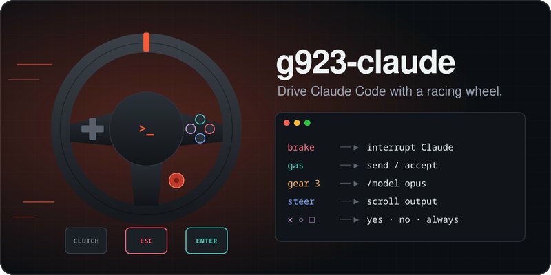
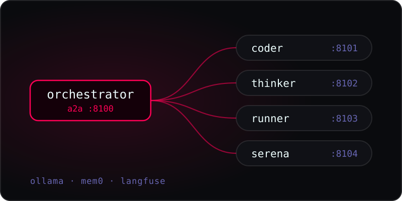
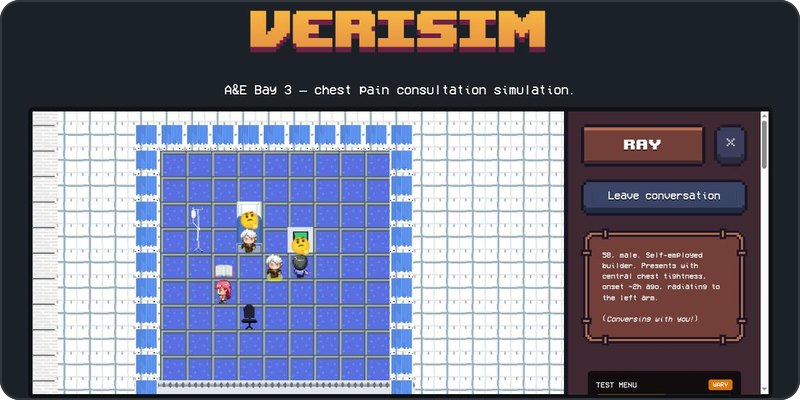
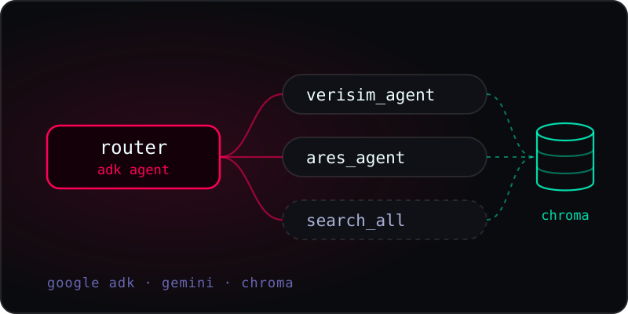

I build agentic AI systems: multi-agent orchestration, RAG with proper evaluation, and models that run locally.

[LinkedIn](https://linkedin.com/in/arjun-ashad-z) &nbsp;·&nbsp; Coventry, UK

 

### Selected work

<table>
<tr>
<td width="50%" valign="top">

**[g923-claude](https://github.com/Emperor-Z/g923-claude)** 
Drive Claude Code with a racing wheel. Brake interrupts, gas sends, gears switch models, and the wheel buzzes when Claude needs you. 
Python · evdev · PyPI

</td>
<td width="50%" valign="top">

**[Ares](https://github.com/Emperor-Z/ares)** 
A fully local multi-agent system. An orchestrator routes coder, thinker, runner and Serena agents over A2A, with memory and tracing. 
Python · Ollama · mem0 · Langfuse

</td>
</tr>
</table>

<table>
<tr>
<td width="50%" valign="top">

**[VeriSim](https://github.com/Emperor-Z/verisim)** 
My MSc dissertation. A clinical training sim where every character is an AI agent, and tests are gated on the patient's consent. 
TypeScript · Convex · Ollama

</td>
<td width="50%" valign="top">

**[DevDesk](https://github.com/Emperor-Z/devdesk)** 
Multi-agent RAG on Google ADK. A router hands each question to a per-project specialist, checked by a deterministic eval. 
Python · Google ADK · Gemini · Chroma

</td>
</tr>
</table>

 

### Experience

**Backend & Full-Stack Engineer** &nbsp;·&nbsp; FundedIn 
Freelance, remote · June 2026 to present

Shipped KYC identity verification gating trader payouts, a brokerage fee engine handling partial-fill capping and settlement, and AWS SQS outbox dispatch for order events, in a Dockerised CI/CD codebase with 13+ test modules.

**Clinical AI / EMR tooling** &nbsp;·&nbsp; SACOM 
Private, under NDA

Ophthalmology workflow modules involving computer vision and voice-assisted documentation. The code and client data stay private under the NDA and healthcare privacy rules.

 

### Stack

Also Ollama · Google ADK · mem0 · Langfuse · Chroma · Hugging Face
